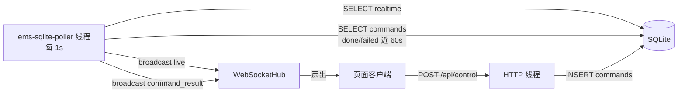
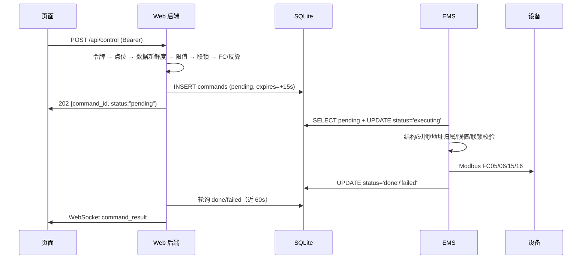

# EMS 架构说明（V2 数据库版）

本文描述 `main` 分支 / `v2` 标签的架构：**EMS 与 Web 后端通过同一个 SQLite 文件交换数据，不使用 MQTT**。V1（MQTT 版）见 `v1-mqtt` 分支。

---

## 1. 系统定位

一套储能站的 **Modbus 主从一体 EMS 网关 + Web 监控**：

- **南向**：Modbus TCP/RTU 主站，采集并控制 PCS、BMS、电表等设备；
- **北向**：Modbus TCP 从站（5020），供既有上位机或调试工具接入；
- **进程间通信**：本地 SQLite 表（实时值、历史趋势、命令队列）；
- **Web**：后端轮询数据库 → WebSocket 推页面；页面 HTTP 提交控制。

### 1.1 拓扑


**没有消息中间件**：两条进程只通过同一个 `.db` 文件耦合，因此必须同机、同路径。

### 1.2 进程职责

| 进程 | 入口 | 职责 | 明确不做 |
|---|---|---|---|
| `ems_gateway` | `src/main.cpp` | Modbus 采集、实时库、写 `realtime`/`history`、认领并执行 `commands`、北向从站 | 不提供 Web 服务 |
| `server.py` | `web_backend/server.py` | 读 `realtime` 推 WebSocket、写 `commands`、历史查询、控制鉴权 | 不直连 EMS 或设备 |
| 页面 | `web_backend/www/` | 渲染、WS 重连、控制按钮可用性 | 不直接访问数据库 |

---

## 2. 目录结构

```text
.
├── CMakeLists.txt          # C++ 构建（libmodbus 静态库 + sqlite3）
├── build.sh / run.sh       # 编译 / 前台运行
├── dev-up.sh / dev-down.sh # 开发链路一键启停（V2 版，不涉及 MQTT）
├── config/
│   ├── points.conf             # 现网点表（旧 9 列格式，后端不兼容）
│   └── simulator/              # 仿真点表与设备（联调默认）
├── inc/ src/               # C++ 头文件与实现
├── third_party/libmodbus/  # libmodbus 预编译库与源码
├── web_backend/
│   ├── server.py           # HTTP + WebSocket 后端
│   ├── requirements.txt    # websockets（无 paho-mqtt）
│   └── www/index.html      # 前端页面
├── data/                   # SQLite 库
├── logs/                   # 运行日志（logs/v2/ 为脚本输出）
└── docs/                   # 架构说明、运行手册
```

---

## 3. EMS 进程内部

| 模块 | 文件 | 职责 |
|---|---|---|
| 启动与调度 | `main.cpp` | 参数解析、服务组装、100ms/1s/Ns 主循环、信号处理 |
| 设备轮询 | `PollerManager` / `DevicePoller` | 每设备一线程，连接重试、分组轮询、写操作 |
| Modbus 客户端 | `ModbusClient` | 封装 libmodbus TCP/RTU |
| 点表分组 | `PointGroup` | 连续地址合并成单帧读 |
| 实时库 | `RealTimeDB` | `deviceId.pointId → {value, quality, ts}`，进程内存 |
| 存储与命令 | `HistoryStore` | 写 `realtime`/`history`、认领 `commands`、回写结果、保留期清理 |
| 北向从站 | `ModbusServer` | TCP 5020 从站，内存值同步到映射区 |
| 日志 | `Logger` | 全局日志 + 每设备独立文件 |

### 3.1 启动顺序

1. 注册 `SIGINT` / `SIGTERM` → `g_running = false`。
2. `parseArgs()` 读参数与环境变量，越界直接退出（码 2）。
3. 建 `logs/`、`data/`，初始化日志（`logs/ems.log` 10MB×5 轮转），为每设备追加 `logs/DeviceN.log`。
4. 打开 `HistoryStore`（建表 + WAL）。失败只告警，每 30 秒重试。
5. 加载点表与设备配置，校验点位引用的设备、联锁反馈点是否存在，失败拒绝启动。
6. 初始化北向 `ModbusServer(5020)`（映射区 65536 全地址空间），绑定实时库与点表。
7. `PollerManager.start()` 启动每设备线程。
8. 注册北向写回调，从站进独立线程。
9. 进入主循环。

### 3.2 主循环节拍

| 周期 | 动作 |
|---|---|
| 100 ms | `fetchPendingCommands()` 认领命令 → 校验 → Modbus 写入 → `completeCommand()` |
| 1 s | `RealTimeDB::snapshot()` → `storeSnapshot(..., storeHistory)` 全量 upsert `realtime` |
| `--history-interval-sec`（默认 60 s） | 同上调用中额外写入 `history`（仅 `quality==GOOD`） |

三者共用 `sleep_until(min(...))` 单线程调度，无并发写库。

---

## 4. 南向采集

- **分组建帧**：同设备 YC 点按连续地址合并（读输入寄存器），YX 读离散输入。
- **解码**：`U16` 无符号、`S16` 按 `int16_t`，再 `value = raw * scale + offset`。
- **死区**：`updateIfChanged()` 带死区（点位第 13 列），变化小于死区不更新内存值。
- **质量码**：整组读失败 → 该组全部点标 `BAD`；成功回 `GOOD`。
- **失败重连**：单组连续失败 3 次触发重连；线程按 **2→4→8→10 s** 指数退避。
- **轮询节拍**：100 ms tick，组内按 `pollMs`（第 12 列）到期才发请求。

---

## 5. 数据契约（SQLite）

数据库开启 `WAL` + `synchronous=NORMAL`，EMS 与后端并发读写（读不阻塞写）。

### 5.1 表结构

```sql
CREATE TABLE realtime (          -- 实时值，全量覆盖
  tag TEXT PRIMARY KEY, value REAL NOT NULL, ts INTEGER NOT NULL,
  quality INTEGER NOT NULL DEFAULT 1 CHECK(quality BETWEEN 0 AND 3)
) WITHOUT ROWID;

CREATE TABLE history (           -- 稀疏趋势
  tag TEXT NOT NULL, ts INTEGER NOT NULL, value REAL NOT NULL,
  quality INTEGER NOT NULL DEFAULT 1 CHECK(quality BETWEEN 0 AND 3),
  PRIMARY KEY(tag, ts)
) WITHOUT ROWID;
CREATE INDEX idx_history_tag_ts ON history(tag, ts);

CREATE TABLE commands (          -- 命令队列 + 审计
  command_id TEXT PRIMARY KEY, issued_at_ms INTEGER NOT NULL,
  expires_at_ms INTEGER NOT NULL, action TEXT NOT NULL, params TEXT NOT NULL,
  status TEXT NOT NULL DEFAULT 'pending'
    CHECK(status IN ('pending','executing','done','failed')),
  result TEXT, done_ts INTEGER
);
CREATE INDEX idx_commands_status_id ON commands(status, issued_at_ms);
```

后端启动时会检查 `history` 是否有 `quality` 列，缺失则 `ALTER TABLE` 补齐（兼容旧库）。

### 5.2 写入语义

| 表 | 写入者 | 语句 | 频率 |
|---|---|---|---|
| `realtime` | EMS | `INSERT ... ON CONFLICT(tag) DO UPDATE` | 每 1 秒，全量点位（含异常质量） |
| `history` | EMS | `INSERT OR REPLACE` | 每 `--history-interval-sec`，仅 `quality==GOOD` |
| `commands` | 后端 | `INSERT ... status='pending'` | 每次控制请求 |
| `commands` | EMS | `UPDATE ... status='executing'`（认领）→ `done/failed` | 认领 100ms 轮询，完成即回写 |

`realtime.ts` 优先取点位自身更新时间（`RTV.ts`），否则用采样时间——页面据此判断“数据是否陈旧”。

### 5.3 质量码与命令状态

- 质量码：`1` 正常、`0` 异常、`2` 陈旧、`3` 未初始化（后端会把超过 5 秒未更新的点降级为 `2`）。
- 命令状态机：`pending → executing → done | failed`；只有 `executing` 才能被回写为终态。

### 5.4 保留策略

| 数据 | 保留 | 清理时机 |
|---|---|---|
| `history` | `--history-days`（默认 7 天） | EMS 每小时检查一次 |
| `commands` 终态记录 | 30 天（`done_ts` 早于阈值） | 同上；`pending/executing` 不清理 |

---

## 6. Web 后端

### 6.1 运行模型



- **轮询线程** `ems-sqlite-poller`：每 1 秒读一次 `realtime` 全表 → 组装快照 → 广播 `{"type":"live"}`。
- **命令结果推送**：同一线程查询最近 60 秒内 `done/failed` 的命令，按 `(status, done_ts)` 去重后广播 `{"type":"command_result"}`。
- **WebSocket**：独立端口（默认 8081），每客户端 4 帧队列，慢消费者丢旧帧；`ping_interval=20s`。
- **HTTP**：`ThreadingHTTPServer`，默认 8080。

### 6.2 HTTP 接口

| 路径 | 方法 | 鉴权 | 说明 |
|---|---|---|---|
| `/api/config` | GET | 无 | `{websocket_port}` |
| `/api/live` | GET | 无 | 实时快照（点位 + 控制点 + 联锁状态） |
| `/api/history?point=&hours=&limit=` | GET | 无 | 趋势，按桶 `AVG(value)`、`MIN(quality)` |
| `/api/control/status` | GET | Bearer | 校验令牌 |
| `/api/control` | POST | Bearer | `{point_id, value}`，写入 `commands` |
| `/api/commands/<id>` | GET | Bearer | 查命令状态（读 `commands` 表） |
| `/`、`/index.html` | GET | 无 | 返回 `www/index.html` |

`/api/live` 中的 `connected` 判定：`realtime` 中存在 `quality==1` 且 `ts` 距今 ≤ 5 秒的记录。

**错误码**

| 码 | 场景 |
|---|---|
| 400 | 请求体非法、超限值、YK 非 0/1、YT 反算越界 |
| 401 | 令牌缺失或不匹配 |
| 404 | 点位/命令不存在、路径不存在 |
| 409 | 实时数据陈旧（`connected=false`）、联锁未满足 |
| 503 | 后端未配置令牌、库不可读、命令入队失败 |

---

## 7. 控制链路



### 7.1 三道校验

1. **后端预校验**：Bearer 令牌 → 点位属于 `controls` → `connected` 为真（5 秒新鲜度）→ 值在 `min_value..max_value` → 联锁反馈 `quality==1` 且等于 `interlock_value`。
2. **后端参数换算**：YK 仅 `0/1`（FC05）；YT 反算 `raw=(v-offset)/scale`，`count!=1` 或 `scale==0` 直接拒绝，检查 `U16/S16` 范围（FC06）。
3. **EMS 校验**：JSON 结构、`action=device.write`、FC 合法、地址/数量在协议上限内、地址属于已配置 YK/YT 点、工程量在限值内、联锁满足、未过期。

### 7.2 命令认领（防重复执行的关键）

```sql
BEGIN IMMEDIATE;
SELECT ... WHERE status='pending' ORDER BY issued_at_ms, command_id LIMIT ?;
UPDATE commands SET status='executing', result='EMS 已接收，正在执行'
  WHERE command_id=? AND status='pending';    -- 要求 sqlite3_changes()==1
COMMIT;
```

- 整个「查询 + 认领」在一个 `BEGIN IMMEDIATE` 事务里完成，保证同一命令只被认领一次；
- 任一条认领失败（`changes != 1`）整批回滚，避免半认领；
- 回写终态要求 `status='executing'`，防止两个进程互相覆盖。

---

## 8. 可靠性设计

| 机制 | 位置 | 效果 |
|---|---|---|
| WAL + `synchronous=NORMAL` | SQLite | 读写并发，断电最多丢最近一次提交 |
| `BEGIN IMMEDIATE` 认领 | `HistoryStore::fetchPendingCommands` | 命令不会被执行两次 |
| 命令有效期 | `expires_at_ms`（15 s） | 积压的过期命令自动拒绝 |
| 乐观并发（`WHERE status='pending'` / `'executing'`） | EMS | 防止状态被并发改写 |
| 双层限值 + 联锁 | 后端 + EMS | 前端绕过无效 |
| 存储降级 | `HistoryStore` 失败仅告警 | 采集与控制继续，30 秒后重试 |
| 指数退避重连 | `runPoller` 2→4→8→10 s | 设备掉线不刷屏 |
| 慢客户端保护 | WS 每客户端 4 帧队列 | 页面卡顿不拖垮后端 |
| 日志轮转 | `logs/ems.log` 10MB×5 | 磁盘保护 |

---

## 9. 配置

### 9.1 点表 `points.conf`（17 列）

| 列 | 字段 | 说明 |
|---|---|---|
| 1 | type | `YC` / `YX` / `YK` / `YT` |
| 2 | pointId | 点名，实时库 key = `deviceId.pointId` |
| 3 | desc | 页面标题 |
| 4-5 | southAddr / count | 南向地址与数量 |
| 6-7 | scale / offset | 工程量换算 |
| 8 | unit | 单位 |
| 9 | northAddr | 北向地址 |
| 10 | device | 所属设备（空=适用所有设备） |
| 11 | dataType | `U16` / `S16` / `BOOL` |
| 12-13 | pollMs / deadband | 轮询周期 / 死区 |
| 14-15 | min / max | 控制限值 |
| 16-17 | interlockPoint / interlockValue | 联锁反馈点与期望值 |

> `config/points.conf` 仍是旧 9 列格式，后端会跳过（要求 ≥11 列），Web 联调请用 `config/simulator`。

### 9.2 设备 `devices.conf`

```text
TCP,<deviceId>,<slaveId>,<ip>,<port>
RTU,<deviceId>,<slaveId>,<serialDev>,<baud>,<parity>,<dataBits>[,<stopBits>]
```

### 9.3 EMS 参数

| 参数 | 默认 | 说明 |
|---|---|---|
| `--config DIR` | `config` | 配置目录 |
| `--db FILE` | `data/ems.db` | SQLite 文件（脚本用 `data/ems-v2.db`） |
| `--history-interval-sec` | 60 | 采样周期，1..86400 |
| `--history-days` | 7 | 趋势保留天数，1..365 |
| `--dump` | 关 | 每秒打印实时库 |
| `--set-device N ID TYPE …` | — | 修改第 N 台设备后继续启动 |

环境变量：`EMS_DB_FILE`。**V2 没有 MQTT 相关参数。**

### 9.4 后端参数

| 参数 | 默认 | 说明 |
|---|---|---|
| `--config DIR` | `config/simulator` | 点表目录，须与 EMS 一致 |
| `--db FILE` | `ENV:EMS_DB_FILE` 或 `data/ems.db` | **必须与 EMS 同一个文件** |
| `--bind` / `--port` | `0.0.0.0` / `8080` | HTTP |
| `--ws-bind` / `--ws-port` | 同 `--bind` / `8081` | WebSocket |
| `--history-days` | 7 | 历史查询保留上限 |
| `--control-token` | 空 | 为空则控制接口关闭 |

---

## 10. 与 V1（MQTT 版）的对照

| 方面 | V1 | V2 |
|---|---|---|
| 进程间通信 | MQTT Broker | 共享 SQLite |
| 实时值传输 | `<base>/telemetry`（QoS0 retained） | `realtime` 表，后端 1s 轮询 |
| 命令下发 | `<base>/command`（QoS1） | `commands` 表（`pending` 认领） |
| 命令结果 | `<base>/command/result` | `commands.status` + 后端轮询 |
| 去重 | 内存 LRU + `command_history` | 数据库事务认领（天然一次） |
| 跨机部署 | 支持（Broker 网络可达即可） | **不支持**（同一文件系统） |
| 页面延迟 | 约 1 秒（MQTT 推送） | 约 1 秒（后端轮询） |
| 数据库 | `data/ems.db`（`history` 无 quality） | `data/ems-v2.db`（含 quality） |
| 启动脚本 | 需 Broker | 不需要 Broker |

---

## 11. 已知限制

1. **只能单机**：两个进程必须访问同一个文件系统，无法跨机器部署。
2. **轮询延迟**：后端每 1 秒轮询一次，页面最坏延迟约 1 秒；命令结果依赖“近 60 秒”窗口轮询。
3. **静态资源只服务 `index.html`**：`/` 与 `/index.html` 之外一律 404，打包产物需要改后端（V1 已补静态路由，V2 未补）。
4. **无 CORS**：前端若由独立 dev server 承载，需要后端补 `Access-Control-Allow-Origin` 与 `OPTIONS`。
5. **`executing` 卡死无回收**：EMS 在认领后崩溃，命令会停在 `executing`，没有超时重试机制。
6. **写放大**：`realtime` 每秒全量 upsert（点位多时明显），适合百级点位规模。
7. **令牌是单一共享密钥**：无用户体系、无过期、无频率限制。
8. **北向从站（5020）无鉴权**，生产环境应加白名单或关闭。
9. **旧点表不兼容**：`config/points.conf` 为 9 列格式，需迁移到 17 列才能用于 Web。

---

## 12. 相关文档

- [`docs/运行手册.md`](运行手册.md)：依赖、编译、启动、排错、版本切换。
- V1（MQTT 版）架构：`git show v1:docs/架构说明.md`
