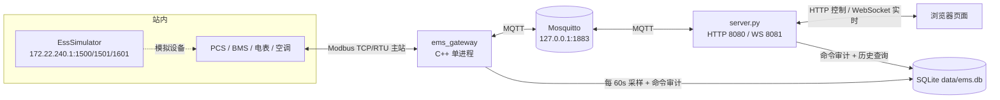
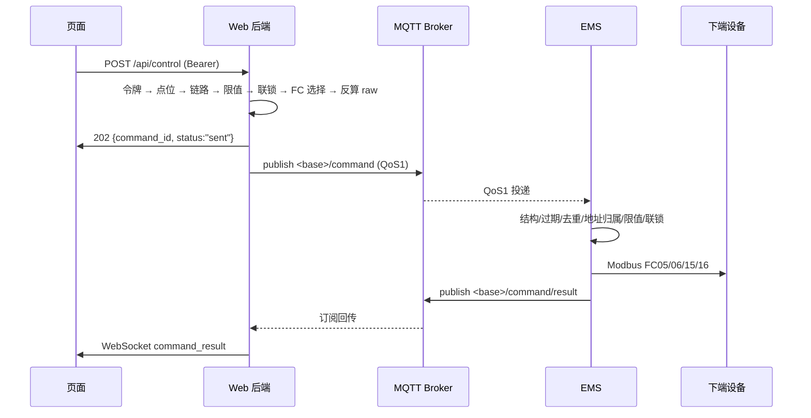

# EMS 网关架构说明

本文描述 `EMS_Demo` 的整体架构、数据流、接口契约、配置项与运维方式。内容以当前代码为准，修改实现后请同步更新本文。

---

## 1. 系统定位

一套储能站的 **Modbus 主从一体 EMS 网关 + Web 监控**：

- **南向**：作为 Modbus TCP/RTU 主站，采集并控制 PCS、BMS、电表、空调等设备；
- **北向**：保留 Modbus TCP 从站，供既有上位机或调试工具接入；
- **实时链路**：EMS 通过本机 MQTT Broker 上送遥测、接收控制命令；
- **Web 链路**：后端用 WebSocket 把最新值推给页面，用 HTTP 承接控制请求；
- **持久化**：SQLite 只承担稀疏历史趋势与命令审计，不参与实时值读取，也不充当命令队列。

### 1.1 拓扑



### 1.2 进程职责

| 进程 | 入口 | 职责 | 明确不做 |
|---|---|---|---|
| `ems_gateway` | `src/main.cpp` | Modbus 采集、实时库、MQTT 收发、控制校验、稀疏历史落库、北向从站 | 不提供 Web 服务；不把实时值写盘 |
| Mosquitto | 系统服务 | 消息总线、保留消息、遗嘱、QoS 1 重投 | 不做业务校验 |
| `server.py` | `web_backend/server.py` | 内存最新值、WebSocket 扇出、控制鉴权与预校验、历史查询、命令审计 | 不直连 EMS 或设备；不从 SQL 读实时值 |
| 页面 | `web_backend/www/` | 渲染、WebSocket 重连、控制按钮可用性 | 不直连 MQTT |

---

## 2. 目录结构

```text
.
├── CMakeLists.txt          # C++ 构建（libmodbus 静态库 + libmosquitto + sqlite3）
├── build.sh                # 一键编译（可选 --arm 交叉编译）
├── dev-up.sh / dev-down.sh # 开发链路一键启停
├── run.sh                  # 单独前台运行 ems_gateway
├── config/                 # 点表、设备配置、Broker 配置
│   ├── points.conf             # 现网点表（旧 9 列格式，Web 后端不兼容）
│   ├── devices.conf            # 现网设备
│   ├── mosquitto-ems.conf      # 本地 Broker 配置（仅回环 + 持久化）
│   └── simulator/              # 仿真点表与设备（Web 与联调使用这套）
├── inc/ src/               # C++ 头文件与实现
├── third_party/libmodbus/  # libmodbus 预编译库与源码
├── web_backend/
│   ├── server.py           # HTTP + WebSocket 后端
│   ├── requirements.txt    # paho-mqtt / websockets
│   └── www/index.html      # 前端页面（可整体替换）
├── data/                   # SQLite 库、mosquitto 持久化目录
└── logs/                   # 运行日志
```

---

## 3. EMS 进程内部结构

| 模块 | 文件 | 关键职责 |
|---|---|---|
| 启动与调度 | `main.cpp` | 参数解析、服务组装、50ms/1s/60s 主循环、信号处理 |
| 设备轮询 | `PollerManager` / `DevicePoller` | 每设备一个线程，连接重试、分组轮询、写操作 |
| Modbus 客户端 | `ModbusClient` | 封装 libmodbus TCP/RTU，超时与错误信息 |
| 点表分组 | `PointGroup` | 把连续地址合并成一帧读请求 |
| 实时库 | `RealTimeDB` | 单例 + 互斥锁，`deviceId.pointId → {value, quality, ts}` |
| MQTT | `MqttBridge` | 收发遥测/命令/结果/状态，断线暂存，自动重连 |
| 北向从站 | `ModbusServer` | TCP 5020 从站，实时库同步到映射区，写回调 |
| 历史存储 | `HistoryStore` | SQLite 稀疏采样、命令审计与去重，保留期清理 |
| 日志 | `Logger` | 全局日志 + 每设备独立日志文件，按大小轮转 |

### 3.1 启动顺序

1. 注册 `SIGINT` / `SIGTERM`，置 `g_running = false` 触发优雅退出。
2. `parseArgs()` 读取命令行与环境变量，越界参数直接退出（退出码 2）。
3. 创建 `logs/`、`data/`，初始化日志（`logs/ems.log`，10MB × 5 轮转），再为每台设备追加 `logs/DeviceN.log`。
4. 打开 `HistoryStore`。失败只告警，不阻断启动（每 30 秒重试）。
5. 加载 `points.conf` 与 `devices.conf`，执行**引用校验**：点位引用的设备必须存在，联锁反馈点必须是已配置的 YX 点。任一失败拒绝启动。
6. 初始化北向 `ModbusServer(5020)`，映射区按 65536 全地址空间分配，绑定实时库与点表。
7. `PollerManager.start()` 启动每设备线程；失败则退出。
8. `MqttBridge.start()` 异步连接 Broker；失败只告警，南向采集与北向继续运行。
9. 注册北向写回调，再把从站放进独立线程运行。
10. 进入主循环；退出时依次 `server.stop()` → `pollerManager.stop()` → `mqtt.stop()` → join → 关闭日志。

### 3.2 主循环节拍

| 周期 | 动作 |
|---|---|
| 50 ms | `mqtt.takeCommands()` 取命令队列 → 校验 → 执行 → 发布结果 |
| 1 s | `RealTimeDB::snapshot()` → 发布遥测（开启 `--dump` 时同时打印实时库） |
| `--history-interval-sec`（默认 60 s） | 只把 `GOOD` 质量点写入 SQLite，并按保留期清理 |

三者用同一个 `sleep_until(min(nextCommandPoll, nextSample, nextHistory))` 调度，单线程无竞态。

---

## 4. 南向采集

- **分组建帧**：同设备的 YC 点按连续地址合并为 `PointGroup`（YC 读输入寄存器，YX 读离散输入），一组请求读多个点，避免逐点建帧。
- **解码**：`U16` 按无符号取，`S16` 按 `int16_t` 解释，再换算 `value = raw * scale + offset`。
- **死区**：`updateIfChanged()` 带死区（点位第 13 列），变化小于死区不写实时库。
- **质量码**：整组读失败时，该组全部点标 `BAD`；成功后回 `GOOD`。枚举为 `GOOD / BAD / STALE / UNINIT`，MQTT 输出 `good/bad/stale/uninitialized`。
- **失败重连**：单组连续失败 3 次触发重连；线程按 **2 s → 4 s → 8 s → 上限 10 s** 指数退避，`stopCv` 可立即唤醒退出。
- **轮询节拍**：线程 100 ms tick，组内按点位 `pollMs`（第 12 列）判断是否到期。
- **写操作**：`writePoint`（单线圈/单寄存器）、`writeCoils` / `writeRegisters`（批量 FC15/FC16）。

---

## 5. 实时库与北向从站

- `RealTimeDB`：进程内单例，key 为 `deviceId.pointId`，提供 `get / snapshot / queryPrefix / markQuality / dump`。
- `ModbusServer`（默认 5020 端口，最多 4 个客户端）：
  - `select()` 监听 + 每客户端独立工作线程；
  - 每次请求前 `syncFromRealTimeDB()` 按 `northAddr` 把点表刷进映射区；
  - 上位机写线圈/保持寄存器触发回调：按 `area` 判断 YK/YT，做限值、联锁校验后下发设备；
  - 写入值原样转发，不重复施加 scale（否则会二次缩放）。

---

## 6. MQTT 接口

默认根主题 `ems/site1`，由 `--mqtt-base-topic` / `EMS_MQTT_BASE_TOPIC` 指定，不允许包含 `+` 或 `#`。

| Topic | 方向 | QoS | retain | 说明 |
|---|---|---|---|---|
| `<base>/telemetry` | EMS → 后端 | 0 | 是 | 每秒全量当前值 |
| `<base>/command` | 后端 → EMS | 1 | 否 | 控制命令 |
| `<base>/command/result` | EMS → 后端 | 1 | 否 | `executing` / `done` / `failed` |
| `<base>/status` | EMS → 后端 | 1 | 是 | EMS 在线状态，含遗嘱 `{"online":false}` |
| `<base>/backend/status` | 后端 → 外部 | 1 | 是 | Web 后端在线状态 |

### 6.1 遥测

```json
{"schema_version":1,"type":"telemetry","timestamp_ms":1793349911000,
 "points":[{"id":"simEmu1.UnitBreaker","value":1,"quality":"good","timestamp_ms":1793349911000}]}
```

非 `GOOD` 或非有限值时 `value` 为 `null`，靠 `quality` 区分原因。

### 6.2 控制命令

```json
{"schema_version":1,"type":"command","command_id":"<uuid>","action":"device.write",
 "params":{"deviceId":"simEmu1","functionCode":5,"address":1000,"value":1},
 "issued_at_ms":1793349988000,"expires_at_ms":1793349993000}
```

- `functionCode` 仅支持 `5 / 6 / 15 / 16`；`15/16` 用 `values` 数组替代 `value`。
- 批量上限：FC15 最多 1968 点，FC16 最多 123 个寄存器；`address + count` 不得越过 65536。
- `expires_at_ms` 由后端设为“当前时间 + 15 秒”，EMS 收到时已过期则拒绝执行。

### 6.3 命令结果

```json
{"schema_version":1,"type":"command_result","command_id":"<uuid>",
 "status":"done","result":"命令已执行写操作；设备实际动作请以反馈遥信/遥测为准",
 "timestamp_ms":1793349989000}
```

`done` 仅代表 Modbus 写请求成功，不代表设备动作完成。

### 6.4 断线与补偿

- EMS 连接 Broker 后发布 `status={"online":true}` 并订阅 `<base>/command`（QoS 1）。
- 结果发布失败时进入 512 条内存 outbox，重连后自动补发。
- 命令入队上限 256 条，溢出直接拒绝并记录错误，避免内存失控。

---

## 7. Web 后端接口契约

`server.py` 同时提供 HTTP（默认 8080）与 WebSocket（默认 8081）服务，静态文件来自 `web_backend/www/`。

### 7.1 HTTP

| 路径 | 方法 | 鉴权 | 说明 |
|---|---|---|---|
| `/api/config` | GET | 无 | `{websocket_port}` |
| `/api/live` | GET | 无 | 实时快照 |
| `/api/history?point=&hours=&limit=` | GET | 无 | 历史趋势 |
| `/api/control/status` | GET | Bearer | 校验令牌，成功返回 `{"authorized":true}` |
| `/api/control` | POST | Bearer | 下发控制，body `{point_id, value}` |
| `/api/commands/<id>` | GET | Bearer | 查询命令状态（内存优先，回落 SQLite） |
| `/`、`/index.html`、其他静态路径 | GET | 无 | 服务 `www/` 下文件 |

**`/api/live` 响应**

```json
{
  "connected": true,
  "last_error": "",
  "last_update_ms": 1793349911000,
  "database_available": true,
  "control_enabled": true,
  "points": [{"id":"simEmu1.UnitBreaker","label":"Unit breaker state","type":"YX",
              "device":"simEmu1","south_address":1000,"address":0,"unit":"",
              "scale":1,"offset":0,"data_type":"BOOL",
              "value":1,"quality":1,"time_ms":1793349911000}],
  "controls": [{"id":"simEmu1.UnitBreakerCmd","type":"YK","min_value":0,"max_value":1,
                "south_address":1000,"interlock_point":"","interlock_value":1,
                "interlock_ok":true}]
}
```

`quality` 在 HTTP 中为数字：`1` 正常、`0` 异常、`2` 陈旧、`3` 未初始化。超过 5 秒未更新的点自动降级为 `2`。

**`connected` 判定**：`MQTT 已连接 && EMS 在线 && 最近 5 秒内收到遥测`，三者全真才为 `true`。

**错误码约定**

| 状态码 | 场景 |
|---|---|
| 400 | 请求体格式、限值、YK 非 0/1、YT 反算越界、点位参数非法 |
| 401 | 令牌缺失或不匹配 |
| 404 | 点位不存在、命令记录不存在、静态文件不存在 |
| 409 | 实时链路未连接、联锁未满足 |
| 503 | 后端未配置控制令牌、历史库不可用、MQTT 发送失败 |

### 7.2 WebSocket

- 端口独立（默认 8081），路径不限；`ping_interval=20s`，单帧上限 1 MB。
- 连接建立即推送一次 `{"type":"live", ...}` 全量快照。
- 之后推送两类消息：

| 消息 | 触发 |
|---|---|
| `{"type":"live","data":{…}}` | 收到遥测、EMS 状态变化、MQTT 断连 |
| `{"type":"command_result","data":{…}}` | 收到 `command/result` |

- 每个客户端 4 帧缓存队列，慢消费者丢旧帧而不是阻塞 MQTT 线程。

---

## 8. 控制链路



### 8.1 四道校验

1. **后端预校验**：Bearer 令牌 → 点位属于 `controls` → `connected` 为真 → 值在 `min_value..max_value` → 联锁反馈 `quality==1` 且等于 `interlock_value`。
2. **后端参数换算**：YK 只允许 `0/1`（FC05）；YT 反算 `raw=(v-offset)/scale`，`scale` 为 0 直接拒绝，并检查 `U16/S16` 范围（FC06）。多寄存器控制当前不支持。
3. **EMS 协议校验**：JSON 结构、`action` 必须是 `device.write`、FC 合法、地址是整数且 ≤ 65535、批量数量符合协议上限、地址区间属于已配置的 YK/YT 点。
4. **EMS 业务校验**：换算后的工程量在点表 `minValue..maxValue` 内，联锁反馈 `GOOD` 且差值 ≤ `1e-4`，`expires_at_ms` 未过期。

### 8.2 去重

QoS 1 是“至少一次”，重复投递必须无害：

- 内存层：`recentResults`（512 条 LRU）命中即重发上次结果，不再执行；
- 持久层：`command_history` 命中同样直接回放；
- 只有 `done` / `failed` 终态参与去重，`executing` 中间态不拦截（顺序处理保证同批次不会并发执行）。

---

## 9. 数据存储

SQLite 使用 WAL + `synchronous=NORMAL`，EMS 与后端共用同一文件（默认 `data/ems.db`）。

### 9.1 表结构

```sql
CREATE TABLE history (            -- 稀疏趋势
  tag TEXT NOT NULL, ts INTEGER NOT NULL, value REAL NOT NULL,
  PRIMARY KEY(tag, ts)) WITHOUT ROWID;

CREATE TABLE command_history (    -- 命令审计与去重
  command_id TEXT PRIMARY KEY, ts INTEGER NOT NULL, done_ts INTEGER,
  point_id TEXT NOT NULL DEFAULT '', value REAL NOT NULL DEFAULT 0,
  status TEXT NOT NULL, result TEXT);
```

### 9.2 保留策略

| 数据 | 写入者 | 频率 | 保留 |
|---|---|---|---|
| `history` | EMS | 默认 60 秒，仅 `GOOD` 点 | `--history-days`，默认 7 天 |
| `command_history` | EMS + 后端 | 每命令若干次 | 固定 30 天 |

- EMS 每小时执行一次过期清理；后端在写审计时也会清理 30 天前的记录。
- 两端写同一行时靠 `ON CONFLICT` 合并：EMS 先写 `command_id/status/result`（`point_id` 为空），后端随后补 `point_id/value/ts` 且不覆盖已有信息。
- 历史查询以只读方式打开（`mode=ro`），按 `hours/limit` 分桶求平均；`hours` 上限为 `--history-days × 24`，`limit` 上限 20000。
- 存储不可用时只降级：EMS 告警并重试，实时与控制继续；后端写审计失败仅记录警告。

---

## 10. 配置说明

### 10.1 点表 `points.conf`（17 列）

| 列 | 字段 | 说明 |
|---|---|---|
| 1 | type | `YC` 遥测 / `YX` 遥信 / `YK` 遥控 / `YT` 遥调 |
| 2 | pointId | 点名，实时库 key 为 `deviceId.pointId` |
| 3 | desc | 描述，页面标题 |
| 4 | southAddr | 南向地址 |
| 5 | count | 寄存器/线圈数量 |
| 6 | scale | 系数 |
| 7 | offset | 偏移 |
| 8 | unit | 单位 |
| 9 | northAddr | 北向地址 |
| 10 | device | 所属设备，空表示适用所有设备 |
| 11 | dataType | `U16` / `S16` / `BOOL` |
| 12 | pollMs | 轮询周期（毫秒） |
| 13 | deadband | 死区 |
| 14 | minValue | 控制下限 |
| 15 | maxValue | 控制上限 |
| 16 | interlockPoint | 联锁反馈点（形如 `device.pointId`） |
| 17 | interlockValue | 联锁期望值，默认 1 |

> `config/points.conf` 目前仍是旧 9 列格式：EMS 能加载（`deviceId` 为空），但 Web 后端要求至少 11 列，会跳过这些行并因缺少 YC/YX 启动失败。Web 联调请使用 `config/simulator/points.conf`。

### 10.2 设备 `devices.conf`

```text
TCP,<deviceId>,<slaveId>,<ip>,<port>
RTU,<deviceId>,<slaveId>,<serialDev>,<baud>,<parity>,<dataBits>[,<stopBits>]
```

### 10.3 EMS 命令行参数

| 参数 | 默认 | 说明 |
|---|---|---|
| `--config DIR` | `config` | 配置目录 |
| `--db FILE` | `data/ems.db` | SQLite 文件 |
| `--mqtt-host` / `--mqtt-port` | `127.0.0.1` / `1883` | Broker 地址 |
| `--mqtt-base-topic` | `ems/site1` | 主题根 |
| `--mqtt-username` / `--mqtt-password` | 空 | 可选认证 |
| `--history-interval-sec` | 60 | 采样周期，范围 1..86400 |
| `--history-days` | 7 | 趋势保留天数，范围 1..365 |
| `--dump` | 关 | 每秒打印实时库 |
| `--set-device N ID TYPE …` | — | 修改第 N 台设备配置后继续启动 |

环境变量：`EMS_DB_FILE`、`EMS_MQTT_HOST`、`EMS_MQTT_PORT`、`EMS_MQTT_BASE_TOPIC`、`EMS_MQTT_USERNAME`、`EMS_MQTT_PASSWORD`。

### 10.4 后端命令行参数

| 参数 | 默认 | 说明 |
|---|---|---|
| `--config DIR` | `config/simulator` | 点表目录，需与 EMS 一致 |
| `--db FILE` | `data/ems.db` | 与 EMS 同一文件 |
| `--bind` / `--port` | `0.0.0.0` / `8080` | HTTP 页面与 API |
| `--ws-bind` / `--ws-port` | 同 `--bind` / `8081` | WebSocket |
| `--mqtt-host` / `--mqtt-port` / `--mqtt-base-topic` | 同 EMS | 必须一致 |
| `--history-days` | 7 | 历史查询保留上限 |
| `--control-token` | 空 | 为空则控制接口整体关闭 |

环境变量：`EMS_WEB_CONTROL_TOKEN` 等。

### 10.5 Broker `config/mosquitto-ems.conf`

```conf
listener 1883 127.0.0.1   # 仅回环
allow_anonymous true      # 仅因绑定回环才可接受
persistence true
persistence_location data/mosquitto/
autosave_interval 60
```

- 相对路径按 Broker 工作目录解析，末尾必须带 `/`，目录需已存在（仓库含 `data/mosquitto/.gitkeep`）。
- 装机为 systemd 服务时，配置应改成 `mosquitto` 用户可写的绝对路径（如 `/var/lib/mosquitto/`）。
- **禁止**在 `allow_anonymous true` 时改成 `0.0.0.0` 或新增非回环 listener：能连上该端口的任何人都可以向 `<base>/command` 发命令驱动设备。

---

## 11. 可靠性设计

| 机制 | 位置 | 效果 |
|---|---|---|
| 命令去重 | EMS 内存 512 条 + `command_history` | QoS 1 重投不重复写设备 |
| 命令有效期 | `expires_at_ms`（15 s） | 断网积压的旧命令自动失效 |
| 双层联锁 | 后端预判 + EMS 强校验 | 防止前端绕过 |
| 双层限值 | 后端 `min/max` + EMS `min/max` | 防止越限下发 |
| 队列上限 | 命令 256、结果 outbox 512、WS 每客户端 4 帧 | 洪水与慢消费者不拖垮核心 |
| 存储降级 | `HistoryStore` 失败仅告警 | 存储故障不影响实时与控制 |
| 指数退避重连 | `runPoller` 2→4→8→10 s | 设备掉线不刷屏、不空转 |
| 日志轮转 | `logs/ems.log` 10MB×5 + 每设备文件 | 现场排查与磁盘保护 |
| 优雅退出 | 信号 → 停服务 → join → 关库 | 不留半连接与脏事务 |

---

## 12. 运行与运维

### 12.1 编译

```bash
./build.sh            # 本机编译
./build.sh --arm      # 交叉编译 ARM64
```

### 12.2 本地联调

```bash
./dev-up.sh           # 起 Broker(端口占用则复用)/EMS/后端，打印令牌与链路状态
./dev-down.sh         # 停止 dev-up 拉起的进程（不动系统 mosquitto）
```

### 12.3 生产部署

```bash
sudo cp config/mosquitto-ems.conf /etc/mosquitto/conf.d/ems.conf
sudo systemctl enable --now mosquitto
export EMS_WEB_CONTROL_TOKEN="$(openssl rand -hex 32)"
./build/ems_gateway --config config/simulator --db data/ems.db \
  --mqtt-host 127.0.0.1 --mqtt-port 1883 --mqtt-base-topic ems/site1
python web_backend/server.py --config config/simulator --db data/ems.db \
  --mqtt-host 127.0.0.1 --mqtt-port 1883 --mqtt-base-topic ems/site1 \
  --bind 0.0.0.0 --port 8080 --ws-bind 0.0.0.0 --ws-port 8081
```

### 12.4 日志

| 文件 | 内容 |
|---|---|
| `logs/ems.log` | 全局日志（启动、配置、MQTT、命令、历史） |
| `logs/DeviceN.log` | 第 N 台设备的连接与轮询日志 |
| `logs/dev-up/*.log` | `dev-up.sh` 拉起的各进程输出 |

### 12.5 替换前端

把打包产物整体拷贝到 `web_backend/www/` 即可：

- 支持任意扩展名静态资源与 SPA 深链接回落（无扩展名的未知路径返回 `index.html`）；
- 缺失的带扩展名资源返回 404；
- 仅服务 `www/` 内部文件，目录穿越一律 404；
- 跨源（独立 dev server）访问需要后端补充 CORS 与 `OPTIONS` 处理，当前未实现。

---

## 13. 已知限制

1. `config/points.conf` 仍是旧 9 列格式，Web 后端无法解析，需迁移到新格式才能用于现网页面。
2. 控制令牌是单一共享密钥，无用户体系、无过期、无频率限制；页面刷新后需重新输入。
3. 遥测为 QoS 0 + retained，EMS 重启瞬间后端可能先收到旧快照，靠 5 秒新鲜度判定兜底。
4. `done` 只表示 Modbus 写请求成功，缺少“命令 → 反馈确认”的超时判定。
5. 北向 Modbus 从站（5020）无鉴权，生产环境应加白名单或关闭。
6. 多寄存器 YT 控制未实现，Web 端只支持单寄存器。
7. 命令去重窗口受内存 512 条与 30 天审计限制，超出窗口的极老消息重投仍可能再次执行。
